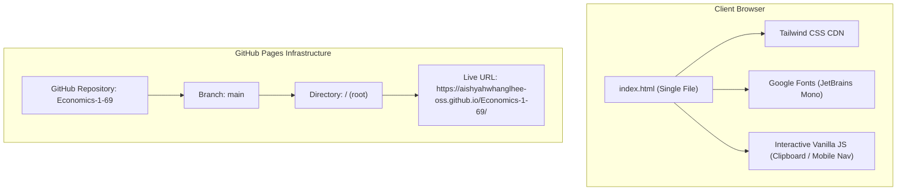

# Implementation Plan: Aisha — Economist & Quantitative Data Analyst Portfolio

A high-performance, futuristic **Cyberpunk** portfolio designed for **Aisha**, an Economics student at **Ramkhamhaeng University** specializing in Finance, Econometrics, and Quantitative Data Modeling. Structured as a single self-contained file (`index.html`) optimized for zero-dependency hosting on **GitHub Pages**.

---

## 1. Goal & Architecture Overview

Create and maintain a responsive, modern Cyberpunk-themed web portfolio that communicates complex quantitative economics, econometrics research, and data analysis skills with high visual impact.



---

## 2. Technical & Visual Specifications

### A. Design & Cyberpunk Theme Tokens
- **Background Color**: `#0A0A12` (Ultra-Dark Void)
- **Card Background**: `#121220` (Dark Metallic with glassmorphism `backdrop-blur-md`)
- **Border Tone**: `#1F1F35`
- **Neon Color Accents**:
  - **Neon Pink**: `#FF007F` (Primary action & emphasis)
  - **Electric Purple**: `#9D4EDD` (Secondary glow & gradients)
  - **Neon Cyan**: `#00F5FF` (Code, live badges, and terminal indicators)
- **Typography**: Google Fonts — `JetBrains Mono` across all headings, code blocks, navigation, and body copy.
- **Visual Effects**: Ambient radial grid lines (`48px x 48px`), CRT scanline overlay, glowing gradient text, and hover elevation with neon box shadows.

---

## 3. Structural Sections Breakdown

### Section 1: Sticky Navigation Bar
- **Logo**: `<AW./>` with cyan/pink dual glow and hover transformation.
- **Navigation Links**:
  - `// Projects` (Smooth scroll to `#projects`)
  - `// About` (Smooth scroll to `#about`)
  - `// Contact` (Smooth scroll to `#contact`)
- **Direct Action**: Neon-bordered `Hire / Connect` button.
- **Mobile Support**: Responsive hamburger menu with animated dropdown links.

### Section 2: Hero Section
- **Pulsing Badge**: `ECONOMICS & DATA ANALYTICS` with animated cyan ping radar dot.
- **Main Heading**: Bold Cyberpunk heading `"Aisha"` with multi-color gradient clipping (`#FF007F` → `#9D4EDD` → `#00F5FF`).
- **Subtitle**: `> Aspiring Data Analyst & Quantitative Researcher`.
- **Mission Statement**: Glass-styled callout card with a left neon pink accent border:
  > *"Turning Complex Data & Economic Theories into Actionable Insights."*
- **Action Buttons**:
  1. `View Projects ↓` — Solid Neon Pink button with glowing drop shadow.
  2. `About & Contact →` — Ghost button with Neon Cyan border and hover fill.
- **Mini R Terminal Runner**: Interactive code block showcasing live econometrics diagnostics (`tidyverse`, `lmtest`, `car::vif`, Durbin-Watson test, and $R^2 = 0.8942$).

### Section 3: Projects Section (3 Interactive Cyberpunk Cards)
Three distinct cards equipped with glowing borders, category badges, summaries, and method tags:

| Project Title | Category | Focus Areas | Key Skill Tags |
| :--- | :--- | :--- | :--- |
| **Thailand Electronics Industry Analysis** | Market Structure & Econometrics | Empirical analysis of market concentration ($CR_4$, $HHI$) and competitive dynamics via Porter's Five Forces framework in Thailand's electronics sector. | `Econometrics`, `CR4 / HHI`, `Market Structure`, `Industry Analysis` |
| **Quantitative Economic Modeling & Econometrics** | Data Analysis & R Programming | Time-series forecasting and econometric diagnostics dealing with autocorrelation and multicollinearity using R. | `R Language`, `Time-Series`, `Autocorrelation`, `ggplot2` |
| **Financial & Quantitative Theory Explorations** | Micro/Macro & Financial Economics | Analytical models evaluating price theory, game-theoretic equilibria, and corporate financial structures. | `Game Theory`, `Microeconomics`, `Price Theory`, `Finance` |

### Section 4: About Me & Contact Section
- **Academic Dossier**:
  - Economics student at **Ramkhamhaeng University**.
  - Specialization: **Finance** and **Quantitative Theory**.
  - Focus: Econometric model specification, statistical hypothesis testing, and quantitative market analysis.
- **Core Skill Badges**:
  - `R Language` (Cyan glow)
  - `SQL` (Pink glow)
  - `Econometrics` (Purple glow)
  - `Financial Economics` (Cyan glow)
  - `ggplot2` (Pink glow)
- **Contact Card**:
  - Direct email input field: `aishyahwhanglhee@gmail.com`.
  - **Copy Email Button**: Instant clipboard integration with feedback state (`"Copied!"`, green color flash, and toast notification).
  - Profile metadata: Location (Bangkok, Thailand) and GitHub link (`github.com/aishyahwhanglhee-oss`).

### Section 5: Minimal Footer
- Status line: `● Aisha // Econometrics & Quantitative Analytics`.
- System telemetry: `System Status: Optimal | Hosted via GitHub Pages`.

---

## 4. File Layout

```text
my_web/
├── index.html               # All-in-one HTML + Tailwind + CSS + JS
├── plan/
│   └── our_plan.md          # Project specification & implementation plan
├── black.png                # Brand logo / favicon
├── css/                     # Legacy reference styles
│   ├── style.css
│   └── article.css
└── js/                      # Legacy reference scripts
    └── main.js
```

---

## 5. Deployment Guide: GitHub Pages

### A. Local Validation
Open [index.html](file:///C:/Users/aishyah/OneDrive/Desktop/my_web/index.html) in any modern browser to verify:
- Navigation anchor jumping (`#projects`, `#about`, `#contact`).
- Copy email clipboard functionality and toast notification.
- Responsive scaling on mobile/tablet screens.

### B. Git Push Workflow
```powershell
# Stage the modified index.html and plan
git add index.html plan/our_plan.md

# Commit changes
git commit -m "feat: Cyberpunk portfolio for Aisha & implementation plan"

# Push to GitHub
git push origin main
```

### C. GitHub Pages Setup
1. Open the repository on GitHub: `https://github.com/aishyahwhanglhee-oss/Economics-1-69`.
2. Go to **Settings** > **Pages**.
3. Under **Build and deployment**:
   - Source: **Deploy from a branch**
   - Branch: `main`
   - Folder: `/ (root)`
4. Click **Save**. The website will be live at:  
   `https://aishyahwhanglhee-oss.github.io/Economics-1-69/`
